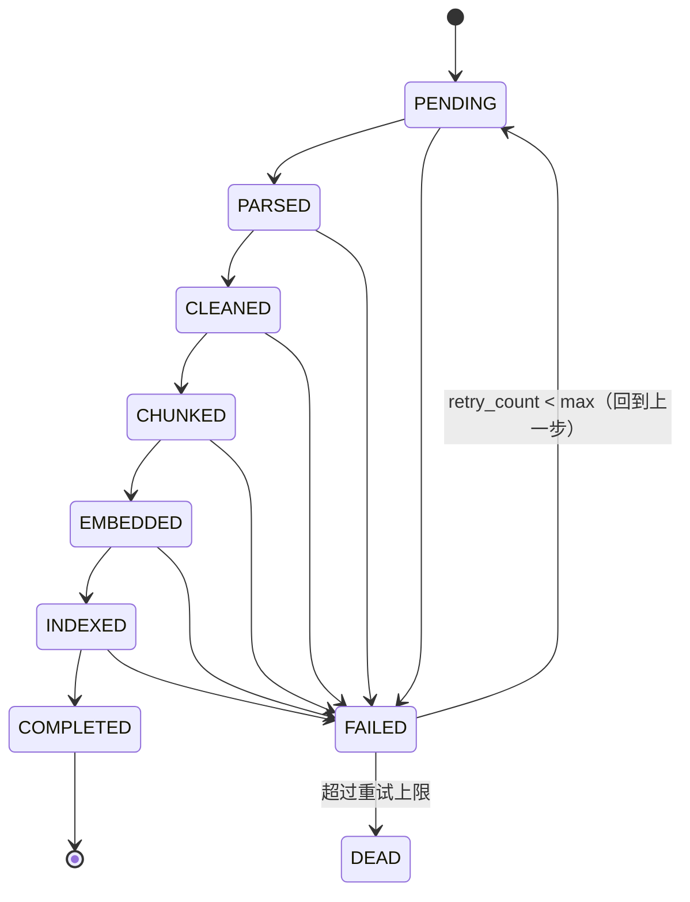

# ADR-0007: Ingestion 用数据库驱动的状态机

- 状态：已接受
- 日期：2026-10-10
- 影响范围：`knowit-ingestion`、`ingestion_task` 表

## 背景

一次文档 ingestion 要跑 7 步：读取 → 解析 → 清洗 → 切片 → 向量化 → 索引 → 完成。

一份 500 页的 PDF，解析 + 切片 + 向量化轻松超过 10 分钟；一个知识库首次导入 200 份文档，
要跑几个小时。

如果这只是一条 `@Async` 方法，问题会很多：
- **进程重启，全部重头再来**（10 分钟 × N 份文档，现场运维会疯）
- 失败在第 5 步，前 4 步的成果全部丢弃
- 无法回答"现在到哪一步了"——用户界面只能显示一个转圈的进度条
- 无法实现"重试单个失败任务"
- 无法实现"增量重建索引"

而被参考项目 Argus 用的是 `Spring Event + @Async + @Retryable`，
简单但正是上面这些问题的集大成者。

## 决定

**ingestion 是一个由数据库状态机驱动的管道**，而不是一个异步方法。

- 状态表 `ingestion_task` 是唯一真相源：`state`、`retry_count`、`error_message`、`step_payload`
- 每一步的产物落库或落对象存储，**不放在内存里往下传**
- 一个消费循环（`@Async` + 虚拟线程 + 数据库轮询或 `SELECT ... FOR UPDATE SKIP LOCKED`）领取 `PENDING` 任务推进状态
- 任一步失败 → `FAILED` + 记录 `retry_count`；`retry_count < max` 时回到上一步重试，超过则 `DEAD`
- `ingest()` 是**幂等**的：同一 `(documentId, profileHash)` 重复调用不重复索引

## 后果

### 正面
- **断点续跑**：进程杀掉重启，从 `step_payload` 记录的位置继续，不重复劳动
- **进度可见**：`state` 就是进度，界面显示"正在向量化 (3/5)"而不是一个假进度条
- **重试可控**：可以单独重试某个失败文档，不用重跑整个知识库
- 索引重建 = 把已 `COMPLETED` 的任务按新 profileHash 重新入队
- 排查问题有据可查（`error_message` + `step_payload`）

### 负面 / 代价
- 实现复杂度明显高于 `@Async`：要设计状态、轮询/锁、并发控制
- 数据库成为管道瓶颈（写入 `ingestion_task` 的状态更新）
- "哪个步骤的产物放哪"要有明确约定，否则 `step_payload` 会变成垃圾字段

## 考虑过的替代方案

| 方案 | 为什么否 |
|---|---|
| `@Async` 方法直跑（Argus 方案） | 无法断点续跑、无进度、无法单独重试、重启全丢 |
| Spring Batch | 重量级，为离线批处理设计，概念多且与我们的"按需单文档"模型不匹配 |
| 引入 RabbitMQ / RocketMQ | Lite 版不引 MQ（多一个要运维的组件）；且单机场景数据库队列已足够 |
| Quartz 定时调度 | 解决的是"定时触发"而不是"状态推进"，混进来只会更复杂 |

**何时重新评估**：需要多节点并行消费 ingestion（大规模并发导入）时，
把轮询换成 MQ，状态机本身不用动。

## 验证方式

- P1 验收：导入 50 页 PDF 到第 5 步时 `kill -9`，重启后从 `EMBEDDED` 继续，
  总耗时 < 全量的 1.5 倍，且不产生重复 chunk
- 单元测试覆盖每个状态的合法转移与非法转移（ArchUnit / 状态机测试）
- 并发 10 个文档同时 ingestion，不产生重复 chunk（幂等性测试）
