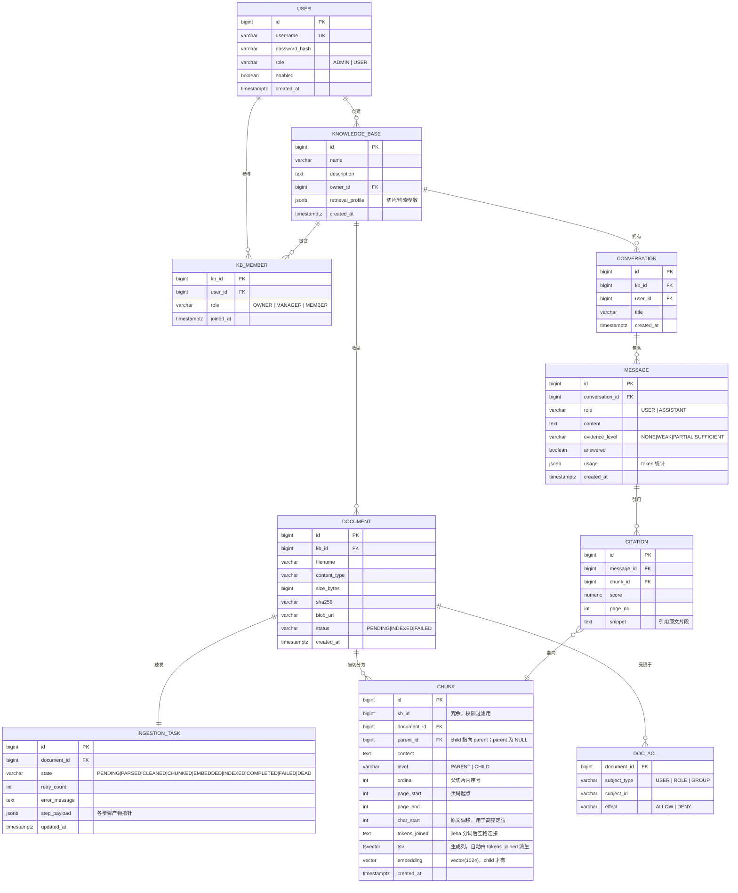

# 核心数据模型

## 1. 设计原则

1. **KnowledgeBase 是一等公民**，与协作组织分离。Argus 把 Group 当知识库用，
   导致"知识库"和"协作组"两个概念纠缠，我们不复用这个错误。
2. **Chunk 双层级**（parent / child）在索引时组织好上下文，查询时不做猜测。
3. **权限数据可被 SQL 直接过滤**：`chunk` 上冗余 `kb_id` 与 `acl`，
   使检索时的权限过滤能合并进同一条 SQL，而不是查回来再筛。
4. **DDL 全部 Flyway 版本化**，从 `V1__baseline.sql` 开始，不许手工改生产库。

## 2. ER 图



## 3. 索引策略

| 查询 | 索引 | 说明 |
|---|---|---|
| 向量语义召回 | `CREATE INDEX idx_chunk_embedding_hnsw ON chunk USING hnsw (embedding vector_cosine_ops) WITH (m=16, ef_construction=64)` | HNSW，召回率/内存平衡点 |
| 关键词全文召回 | `CREATE INDEX idx_chunk_tsv ON chunk USING gin (tsv)` | 走生成列，无需应用层维护 |
| 权限 + KB 过滤 | `CREATE INDEX idx_chunk_kb_parent ON chunk (kb_id, level) WHERE parent_id IS NULL` | 复合过滤，父切片定位 |
| ACL 过滤 | `CREATE INDEX idx_doc_acl ON doc_acl (document_id, effect)` | ADR-0011 的 `NOT EXISTS` 依赖它收敛 |
| 文档列表 | `CREATE INDEX idx_doc_kb_status ON document (kb_id, status)` | |
| 摄取任务轮询 | `CREATE INDEX idx_ingestion_state ON ingestion_task (state, updated_at)` | ADR-0007 的消费循环 |

## 3.1 `tsv` 用生成列，而不是应用层维护

```sql
tokens_joined text NOT NULL,
tsv tsvector GENERATED ALWAYS AS (to_tsvector('simple', tokens_joined)) STORED
```

**为什么是生成列**：分词在 Java 侧用 jieba4j 完成（理由见
[ADR-0004](adr/0004-application-layer-chinese-tokenization.md)），
但 `tsv` 不应该由应用层负责写——那会出现"content 写了、tsv 忘了"的不一致状态，
而这种 bug 在检索时才暴露，排查成本极高。

生成列让 PG 自己保证 `tsv` 永远等于 `tokens_joined` 的派生结果：
应用层只写一列，不需要触发器，不需要在 DAO 里重复这段表达式。

**为什么用 `'simple'` 配置**：`simple` 不做任何词干还原和停用词过滤，
正好符合我们的用法——分词已经由 jieba 完成，PG 只需要按空格切。
用 `english` 配置反而会错误地处理中文 token。

**代价**：不再保留 `text[]` 数组结构，若将来要做词频统计
（`CHUNK_TERM` 倒排表）需要重新拆分。当前没有该计划，因此代价为零。
领域模型里的 `Chunk.tokens` 仍保留 `List<String>`，由 DAO 层
`String.join(" ", tokens)` 写入本列——领域层不受存储细节影响。

## 4. 检索配置 `retrieval_profile`（jsonb）

```json
{
  "chunking": {
    "childTargetTokens": 256,
    "childOverlapTokens": 32,
    "parentTargetTokens": 1024,
    "strategy": "STRUCTURAL"
  },
  "retrieval": {
    "vectorTopK": 20,
    "keywordTopK": 20,
    "fusedTopK": 40,
    "rerankTopN": 5,
    "rrfK": 60,
    "rerankEnabled": true
  },
  "answering": {
    "mode": "EXCERPT",
    "maxContextTokens": 1024,
    "temperature": 0.1
  }
}
```

不同知识库可以完全不同：制度文件用 `STRUCTURAL` 切分 + 大 parent；
代码注释用 `FIXED_LINE` 切分 + 小 child。
配置变更会触发 `profileHash` 变化，`IngestionPipeline` 据此判断是否需要重建索引。

## 5. DDL 基线

`sql/` 目录由 Flyway 接管，第一条是 `V1__baseline.sql`。

纪律（[ADR-0012](adr/0012-flyway-versioned-ddl.md)）：
- 只准追加 `V<n>__*.sql`，已发布的脚本**永不许修改**。
- 每次 schema 变更必须配套一个回滚说明（写在迁移脚本头部注释）。
- 现场升级路径：`flyway migrate` 一条命令，升级前自动备份提示。
