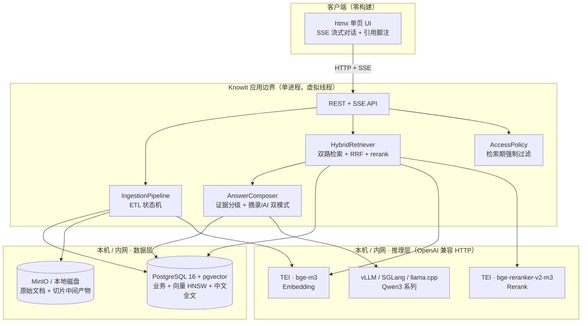
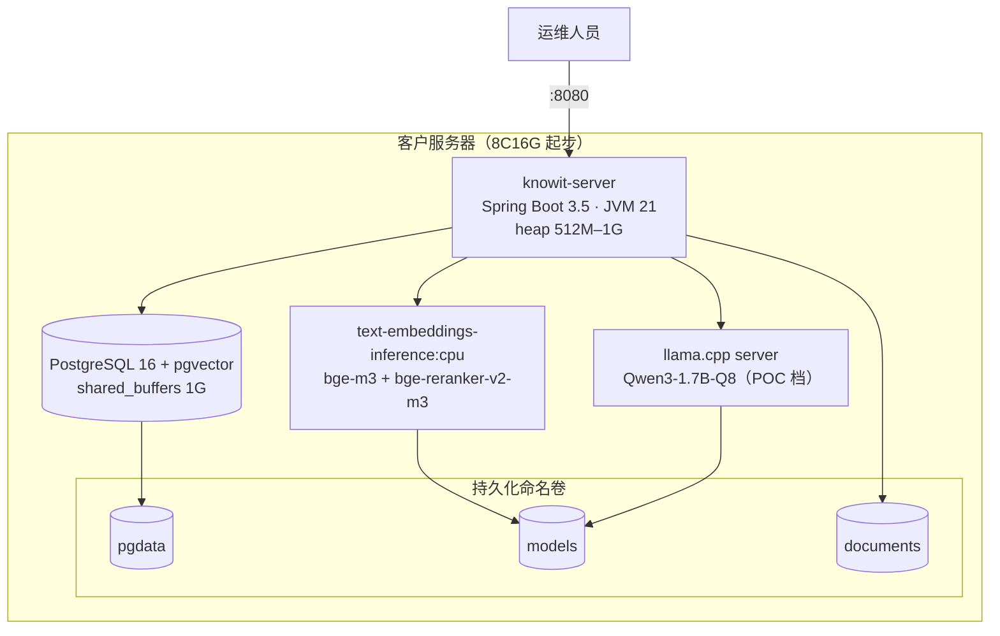
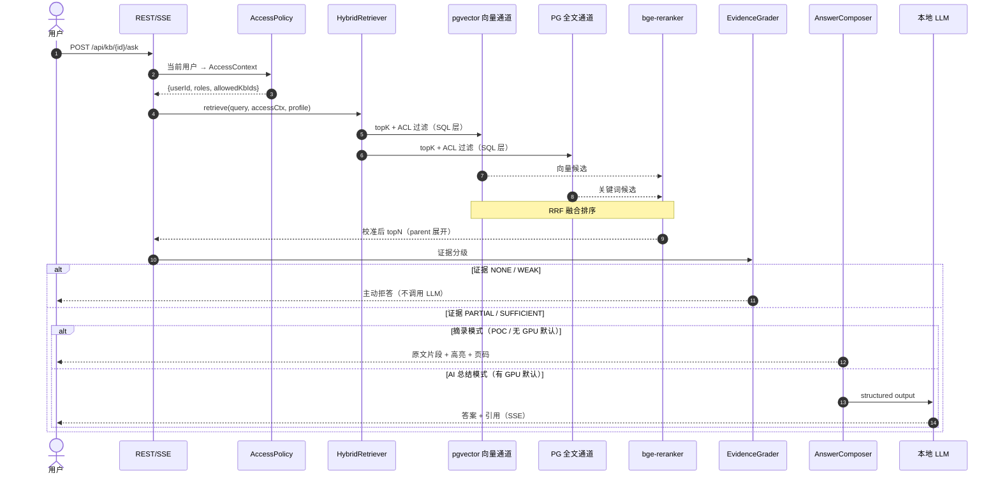
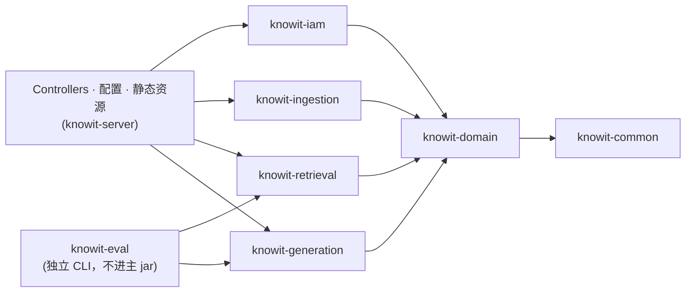

# 架构总览

## 1. 问题

中小企业要的是："一个能查内部文档的 AI，但数据绝对不能传出去，最好就在我们自己机房里跑。"

这句话拆开是三个约束：

| 约束 | 工程含义 |
|---|---|
| 能查内部文档 | 解析 → 切片 → 索引 → 检索 → 生成，全链路 RAG |
| 数据不能出去 | 推理、存储、解析**全部内网**，零外网依赖 |
| 自己机房跑 | 硬件弱（常为 8C16G 无显卡）、无人专职运维、一键部署 |

**第三个约束是真正的设计驱动力。** 它决定了我们不能照搬"PG + ES + MinIO + MQ + vLLM"的企业级方案，
也不能假设客户有 24G 显卡。KnowIt 的架构，本质上是在"弱硬件 + 零运维"的边界内，
把一个 RAG 系统做到可信可用。

---

## 2. 系统上下文

**关键性质**：图中除了 Docker 内部网络，**没有任何一条边通向机房外**。
模型层全部通过 OpenAI 兼容 HTTP 契约对接，
DashScope 仅作为本地开发的旁路（[ADR-0002](adr/0002-full-local-inference-openai-compatible-gateway.md)），
生产 compose 中不存在该依赖。

> 本图附带页码与文字注释的源文件见 [`diagrams/01-system-context.mmd`](diagrams/01-system-context.mmd)。
> 每张图都有对应的 `.mmd` 文件，便于 IDE Mermaid 插件渲染和定制。

---

## 3. 部署拓扑

**四个容器，一条 `docker compose up`。** 没有 Elasticsearch、没有 MQ、没有 Nacos、没有 Redis。
对比主流方案（7+ 组件、动辄 16G 内存起步），这是 Lite 版的核心承诺。

---

## 4. 一次问答的生命周期

三点设计要点：

1. **权限过滤发生在 SQL 层**，不是查回来再筛（[ADR-0011](adr/0011-access-context-as-retriever-parameter.md)）。
2. **证据不足时不调 LLM**。四级证据分级是拒答能力的来源。
3. **摘录模式不调 LLM**。这是弱硬件下的默认体验（[ADR-0006](adr/0006-excerpt-first-answering-mode.md)）。

---

## 5. 模块划分

八个 Maven 模块，一个进程：

依赖方向严格单向，`knowit-domain` 不依赖任何业务模块。详见
[模块划分与深模块设计](modules.md)。

---

## 6. 技术选型清单

| 层 | 选型 | 版本 | 为什么是它 |
|---|---|---|---|
| 语言 | Java | 21 | 虚拟线程对 I/O 密集型 RAG 管道是决定性优势 |
| 框架 | Spring Boot | 3.5.x | 主流版本，生态完整 |
| RAG 骨架 | Spring AI `spring-ai-rag` | 1.1.x | 模块化管道：QueryTransformer→Retriever→Compressor |
| Agent 层 | Spring AI Alibaba Graph | 1.1.2.0 | P4 预留，前期不引入 |
| 解析增强 | LangChain4j | 0.36+ | **仅**用于 `DocumentParser` SPI 的 Tika 实现 |
| 数据库 | PostgreSQL + pgvector | 16+ | 一个库同时当业务库、向量库、中文全文库 |
| 中文分词 | jieba4j | 1.0.3 | 应用层分词，零 C 扩展，国产化平台无痛 |
| 对象存储 | MinIO | latest | S3 兼容，可按需降级为本地磁盘 |
| Embedding | bge-m3 | — | 多语言/长文本/中文俱佳，CPU 可跑 |
| Rerank | bge-reranker-v2-m3 | 0.57B | 提供 RRF 无法给出的绝对分数校准 |
| Chat 模型 | Qwen3 系列 | 1.7B–32B | 中文强、License 宽松、按硬件分档 |
| 数据库迁移 | Flyway | 10+ | 私有化现场升级必须版本化 |
| 测试 | JUnit5 + Testcontainers | — | 有真实 PG 的集成测试，不靠 mock 骗自己 |
| 前端 | htmx + SSE + marked | — | 零构建，`mvn spring-boot:run` 直接看界面 |

---

## 7. 已知的取舍

诚实记录本方案**不做什么**，以及代价：

| 不做 | 后果 | 什么时候必须补 |
|---|---|---|
| 不引入 Elasticsearch | 关键词排序弱于 BM25，靠 rerank 补 | 单 KB 超百万 chunk 且 CPU rerank 成瓶颈 |
| 不引 MQ | Ingestion 管道无法多节点横向扩展 | 需要并行消费 ingestion 任务时 |
| P0 不做分片上传 | 大文件（>20MB）上传体验差 | P1，上传协议已预留 |
| P0 不做 OCR | 扫描件、图片型 PDF 无法检索 | P4，通过 `DocumentParser` SPI 挂 sidecar |
| P0 不做 SSO | 只能账号密码登录 | P3，IAM 层已留 `AuthenticationProvider` SPI |
| 摘录模式无 AI 改写 | 无 GPU 时答案是"原文"而非"总结" | 见 [ADR-0006](adr/0006-excerpt-first-answering-mode.md) 权衡论证 |

---

## 8. 参考但不照抄的开源项目

| 项目 | 学什么 | 明确**不**学什么 |
|---|---|---|
| [DevYangJC/Argus](https://github.com/DevYangJC/Argus) | 版本演进节奏、RRF 融合、四级证据评估、ReactAgent 记忆压缩 | **模型层走 DashScope 云 API**（与私有化根本冲突）、单模块单体、群组即知识库的领域混淆 |
| [MaxKB](https://github.com/1Panel-dev/MaxKB) | 知识库/应用分离的产品形态、商业化分层 | Python 实现，无代码可抄 |
| [RAGFlow](https://github.com/infiniflow/ragflow) | DeepDoc 版面分析思路、表格与多栏 PDF 处理 | Python 实现；Lite 版不引入重量级解析栈 |

> ⚠️ **注意**：`lbx154/Argus` 是同名的**另一个项目**（Python 自主 Agent 框架，Manager→Planner→Engineer⇄Reviewer），
> 与 RAG 知识库无关，参考时不要走错仓库。
