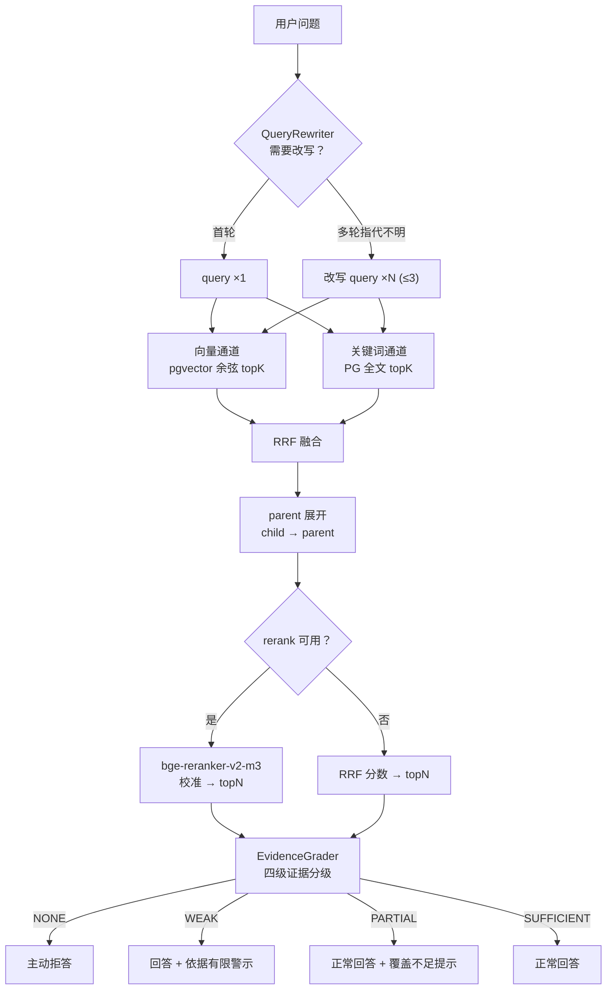

# 检索与生成链路

## 1. 全链路视图



## 2. 各环节设计要点

### 2.1 QueryRewriter

多轮对话中"这个怎么申请？"里的"这个"必须消解。策略：

| 策略 | 触发条件 | 动作 |
|---|---|---|
| `DIRECT` | 首轮 / 问题自包含 | 原文直接检索 |
| `REWRITE` | 检测到指代词且无实体 | 用会话摘要改写为自包含问题 |
| `DECOMPOSE` | 问题包含多个并列子问题 | 拆成 ≤3 条并行检索 |

改写在本地小模型上做（1.7B 足够），**不消耗用户等待时间的关键路径**——
它比生成答案便宜一到两个数量级。

### 2.2 双路召回

**为什么必须双路**：向量检索抓语义，但对企业专有术语（型号、制度编号、人名、化学式）很差；
关键词检索抓字面，但同义改写就废。两者失败模式不重叠。

**为什么能在单 PG 里做**：向量走 pgvector HNSW，关键词走 GIN + tsvector。
两路都是普通 SQL，可以合并进一条查询，也可以并行两条查询后在应用层融合。

### 2.3 RRF 融合

```
rrf(d) = Σ_channel  1 / (k + rank_channel(d))     k = 60
```

**关键洞察**：RRF **只用排名，不用绝对分数**。这正好吸收了 PG 全文检索排序弱于 BM25 的缺点——
`ts_rank` 的分数不校准不影响 RRF，因为排名大致还是对的。
绝对分数的校准交给后面的 cross-encoder rerank（[ADR-0003](adr/0003-lite-single-database-topology.md)）。

### 2.4 parent 展开

child chunk（~256 token）负责精确召回，命中的 child 展开回 parent chunk（~1024 token）后送给 LLM。
上下文在**索引时**已组织好，不是查询时猜邻居。见 [ADR-0005](adr/0005-parent-child-chunking.md)。

### 2.5 rerank

`bge-reranker-v2-m3`（0.57B cross-encoder），TEI CPU 部署。
它为每个 (query, chunk) 对输出一个**真分数**，这是后续证据分级唯一可信的输入。

**CPU 开销估算**：单次打分 20–60ms，rerank 20 个候选约 0.4–1.2s。
在 POC 档这是可接受的；若客户无 GPU 且对延迟敏感，
可在 `retrieval_profile.rerankEnabled` 关掉，代价是证据分级只能退化为基于 RRF 排名的启发式。

### 2.6 四级证据分级

| 等级 | 判定条件 | 行为 |
|---|---|---|
| `NONE` | 召回结果为空，或 top1 rerank 分数 < 0.20 | **主动拒答，不调用 LLM** |
| `WEAK` | 仅单通道命中，或最高分 ∈ [0.20, 0.45) | 回答并标注"依据有限，仅供参考" |
| `PARTIAL` | 双通道命中，或最高分 ∈ [0.45, 0.75) | 正常回答，标注未覆盖的方面 |
| `SUFFICIENT` | 双通道命中且最高分 ≥ 0.75 | 正常回答，禁止臆测 |

阈值**必须按客户实测校准**——不同 embedding 模型、不同文档类型的分数分布完全不同。
校准工具在 `knowit-eval` 里（[路线图](roadmap.md) P3）。

**分级不通过时不调用 LLM**，这既是省钱省时，也是"不编造"的最后一道闸。

### 2.7 两种回答模式

| 模式 | 何时用 | LLM 调用 | 体验 |
|---|---|---|---|
| **摘录模式** `EXCERPT` | 无 GPU / POC 档 / 用户主动选择 | **不调用** | <1s，原文 + 高亮 + 页码 |
| AI 总结模式 `SUMMARY` | 有 GPU / 标准档 | structured output | 3–8s 首字，SSE 流式 |

设计理由见 [ADR-0006](adr/0006-excerpt-first-answering-mode.md)。

### 2.8 引用溯源

每一条 `Citation` 必须携带：

- `page_no`：页码（PDF/Word 从解析阶段提取）
- `snippet`：引用原文片段
- `score`：rerank 校准分
- `char_start`：原文偏移量，用于前端精确高亮

**引用缺失页码 = 该回答不可信**。这是从 P0 就焊死的纪律（[ADR-0014](adr/0014-citation-carry-page-number.md)）。

AI 总结模式下，模型输出的 citations 会与检索到的 EvidenceBundle 做**交叉校验**：
模型编造的引用（chunkId 不存在于 bundle 中）会被丢弃并在日志中告警。
**宁可少一条引用，不可多一条假引用。**

---

## 3. 权限过滤：SQL 层，不是结果层

```sql
-- 错误做法（Argus 的模式）：先检索全库，再在 Java 里按 groupId 筛
SELECT ... FROM chunk ORDER BY embedding <=> ? LIMIT 50;   -- 然后过滤

-- 正确做法：权限条件下推进 SQL
SELECT c.* FROM chunk c
WHERE c.kb_id = ANY(?)
  AND c.level = 'CHILD'
  AND NOT EXISTS (
      SELECT 1 FROM doc_acl a
      WHERE a.document_id = c.document_id
        AND a.effect = 'DENY'
        AND (a.subject_type = 'USER'  AND a.subject_id = ?::text
          OR a.subject_type = 'ROLE'  AND a.subject_id = ?::text))
ORDER BY c.embedding <=> ?
LIMIT 20;
```

区别是本质的：前者**已经越权读过了**，只是没展示；后者**从未读过**。
审计、日志、内存驻留都更干净。见 [ADR-0011](adr/0011-access-context-as-retriever-parameter.md)。

---

## 4. 性能预算

| 环节 | POC 档（8C16G 无卡） | 标准档（1×24G） |
|---|---|---|
| QueryRewriter | ~2s | ~0.3s |
| 双路召回 | ~50ms | ~50ms |
| rerank 20 候选 | 0.4–1.2s | ~0.05s |
| 摘录模式总耗时 | **<2s** | <1s |
| AI 总结首字（1024 token 上下文） | 40–80s | 3–8s |
| AI 总结生成速度 | 12–20 tok/s | 60–100 tok/s |

这张表是"摘录模式优先"的全部理由：**POC 档下 AI 总结模式根本不能作为默认交互形态**。

数字为预估，P0 验收标准第 6 条会实测校准（见[路线图](roadmap.md)）。
