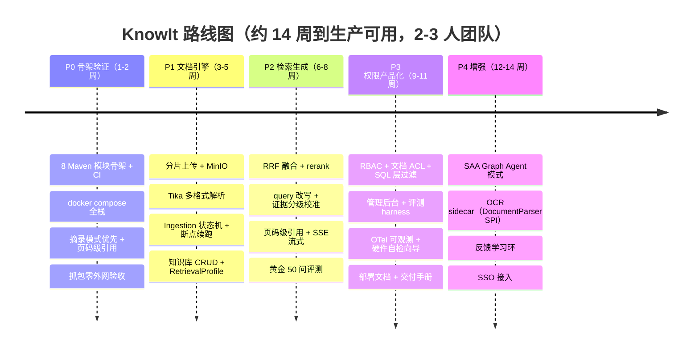

# 路线图与 P0 计划

## 1. 总览



## 2. 各阶段目标与验收

### P0 · 骨架验证（第 1–2 周）

**目标**：把整个方案最大的技术风险清零——证明"全本地 + 单 PG + 弱硬件"下能跑通 RAG 闭环。

**为什么是 P0 而不是先做 UI**：如果 P0 跑不通，后面全是沉没成本。

#### 任务清单

**T0.1 工程骨架**

- [x] `git init` + MIT License + `.gitignore`
- [x] README（中英）、CONTRIBUTING、Issue / PR 模板
- [x] Maven 多模块 + BOM，8 个模块空壳可启动（`mvn spring-boot:run` 返回 200）
- [x] Spotless（google-java-format AOSP 4 空格）+ Checkstyle + 提交前钩子
- [x] ArchUnit 依赖规则测试（`domain` 不依赖 Spring、`common` 不被反向依赖）
- [x] GitHub Actions：JDK 21 Temurin，`build → test → package`

> ✅ **T0.1 已通过完整验证**：`mvn clean verify` 在 9 个模块上全绿
> （19 个测试、ArchUnit 7 条规则、Spotless、Checkstyle 全部通过）。
> 验证过程中修掉的问题与三个环境陷阱记录在
> [ADR-0015](../adr/0015-framework-baseline.md)。

**T0.2 基础设施**

- [x] `sql/V1__baseline.sql`：10 张表 / 14 外键 / 17 CHECK / 4 UNIQUE / 28 索引 / 5 触发器
- [x] **DDL 已真跑验证**：本机 PG 17 单用户模式实际执行，pgvector 三处用桩替换后零错误
- [x] Flyway 接入：`spring.flyway.locations=classpath:db/migration`，`validate-on-migrate=true`
- [x] `sql/` → jar 内 `db/migration/` 的打包映射（`knowit-server/pom.xml` 的 `<resources>`）
- [x] `chunk` 表关键列：`parent_id`、`tokens_joined`、`tsv`（**生成列**）、`page_start/page_end`、`char_start`、`embedding`
- [x] HNSW 向量索引 + GIN 全文索引
- [x] `chunk` 的 parent-child 一致性在**数据库层**用 CHECK 约束强制（与 domain 不变量对齐）
- [x] `deploy/compose.poc.yml`：pgvector（健康检查、只绑回环、UTF8+C 排序、内存预算参数）
- [x] `deploy/.env.example`
- [x] 数据源 / 连接池配置；虚拟线程开启
- [x] 冒烟测试显式排除数据源自动配置，保住"无 Docker 秒级跑完"的快车道
- [ ] **尚未验证**：`CREATE EXTENSION vector`、`VECTOR(1024)`、HNSW 索引 —— 需要真实 pgvector 容器
- [ ] TEI（bge-m3 + rerank）与 llama.cpp 服务进 compose
- [ ] `deploy/models/download.sh`（ModelScope 拉权重）
- [ ] `KnowItDataLayerIT`：Testcontainers 起真实 pgvector 验证迁移；
      用 `@Testcontainers(disabledWithoutDocker = true)`，无 Docker 自动跳过，CI（GitHub runner 自带 Docker）真跑

**T0.3 三个深模块最小实现**

- [ ] `IngestionPipeline`：TXT/MD → 结构感知切片（标题/段落边界）→ parent-child → embedding → 双路索引
- [ ] `HybridRetriever`：pgvector 余弦 topK + jieba4j 分词 → tsvector 全文 topK → **RRF 融合**（T0 允许只有向量通道，关键词通道在 T0 末补齐）
- [ ] `EvidenceGrader`：四级分级（阈值先用默认值，P2 校准）
- [ ] `AnswerComposer`：模板 Prompt + structured output → `{answer, citations[], confidence}`
- [ ] 摘录模式：不调 LLM，直接返回原文片段
- [ ] `AccessContext` 空实现（T0 单用户，但接口签名必须是那个签名）

**T0.4 最小 API + 前端**

- [ ] `POST /api/kb/{id}/ask`（JSON）
- [ ] `POST /api/kb/{id}/ask/stream`（SSE）
- [ ] `POST /api/kb`、`GET /api/kb`（知识库 CRUD 极简版）
- [ ] `POST /api/documents`（单文件直传 ≤20MB，P0 不做分片）
- [ ] `src/main/resources/static/index.html`：htmx + SSE + marked + highlight.js
      · 知识库下拉、文档上传与索引进度、对话框、引用脚注（含页码）、摘录/AI 模式切换
- [ ] **零构建**：`mvn spring-boot:run` 直接看到完整界面

**T0.5 测试**

- [ ] 单元：结构感知 Chunker、RRF（固定输入输出）、PromptBuilder、EvidenceGrader
- [ ] 集成：Testcontainers PG，ingestion → retrieval 全链路；Embedding 用 fake 向量
- [ ] 契约：WireMock 桩 OpenAI 兼容端点
- [ ] 真实模型**只在 knowit-eval 离线跑**，CI 不碰

#### P0 验收标准（六条全过）

| # | 标准 | 怎么验 |
|---|---|---|
| 1 | `docker compose up` 一条命令起全栈，`:8080` 见到对话界面 | 手工 |
| 2 | 上传真实制度文件，进度可见，完成后可查 | 手工 |
| 3 | 10 个文档内问题，**≥8 正确且引用落到正确页码** | knowit-eval |
| 4 | 5 个文档外问题，**≥4 被拒答**（不编造） | knowit-eval |
| 5 | 除 127.0.0.1 与 Docker 内网，**零外网连接** | 容器内抓包 / 网关防火墙日志 |
| 6 | 8C16G 实测首字延迟，回填硬件矩阵表 | 秒表 |

> 第 5 条是"私有化"的硬证明，会写进 README 最显眼的位置。

#### T0.1 验证记录

构建已跑通（`mvn clean verify`，9 模块全绿）：

```
KnowIt ................ SUCCESS   KnowIt :: Retrieval .... SUCCESS
KnowIt :: Common ....... SUCCESS   KnowIt :: Generation ... SUCCESS
KnowIt :: Domain ....... SUCCESS   KnowIt :: Server ....... SUCCESS
KnowIt :: IAM .......... SUCCESS   KnowIt :: Eval ......... SUCCESS
KnowIt :: Ingestion .... SUCCESS

Tests run: 19, Failures: 0, Errors: 0
ArchUnit: 7 条规则全部通过
Spotless / Checkstyle: 0 违规
```

剩余的人工步骤（只需执行一次，且只与版本控制有关）：

```powershell
cd D:\Programing\WebProjects\KnowIt
git init -b main
git add -A
git commit -m "chore: P0 工程骨架（8 模块 + CI + 架构守护 + 文档体系）"
git push -u origin main
```

> 提交后请确认 GitHub Actions 的 CI 为绿。CI 在 Linux 上跑，
> 如果红了且提示 Spotless 格式违规，先看 [ADR-0015](../adr/0015-framework-baseline.md)
> 的「环境陷阱二：Spotless 的平台行尾」——那是这类问题最常见的原因。

---

### P1 · 文档引擎（第 3–5 周）

**目标**：把"能用的文档解析"做扎实。RAG 的质量上限由 ingestion 决定，不由检索决定。

- [ ] 分片上传协议（init → chunk → complete），断点续传 + SHA-256 秒传
- [ ] MinIO 接入，`BlobStorage` SPI + 本地文件系统默认实现
- [ ] Tika 解析：PDF / DOCX / XLSX / PPTX / HTML / TXT / MD
- [ ] 结构感知切分升级：识别标题层级、列表、表格边界；页眉页脚剔除
- [ ] Ingestion 状态机落库，outbox 模式 + 虚拟线程消费 + 幂等重试 + 死信
- [ ] 知识库完整 CRUD + `RetrievalProfile` 编辑
- [ ] 文档预览（高亮命中片段）

**验收**：上传一份 50 页 PDF 制度文件，全链路 < 3 分钟；杀掉进程重启，能从断点续跑不重复索引。

---

### P2 · 检索与生成（第 6–8 周）

**目标**：回答质量与可信度达到"敢给客户看"的水平。

- [ ] RRF 融合全面启用（双路）
- [ ] rerank 接入与开关
- [ ] QueryRewriter（REWRITE / DECOMPOSE 策略）
- [ ] 多轮会话 + 短期记忆压缩
- [ ] 证据分级阈值校准工具（在 knowit-eval 中）
- [ ] 页码级引用 + 原文偏移高亮
- [ ] SSE 流式 + Delta 去重
- [ ] 引用交叉校验（丢弃模型编造的引用）
- [ ] 黄金评测集：50 问 + 期望引用

**验收**：recall@5 ≥ 0.85；拒答准确率 ≥ 0.8；引用页码正确率 ≥ 0.9。

---

### P3 · 权限与产品化（第 9–11 周）

**目标**：从"能跑"变成"能卖"。

- [ ] 用户/角色/权限完整 RBAC
- [ ] 文档级 ACL（`DocumentAcl`）+ **SQL 层过滤落地**
- [ ] SSO 抽象（OIDC / LDAP）+ 至少一个真实实现
- [ ] 管理后台（用户、知识库、成员、审计日志）
- [ ] knowit-eval 完整 harness，可生成评测报告
- [ ] OTel + Micrometer + Actuator；可选 Langfuse 自托管
- [ ] 硬件自检向导（HardwareProbe）
- [ ] 部署文档：四档 compose、硬件矩阵、国产化（麒麟/鲲鹏/昇腾）注意事项
- [ ] 升级指南：Flyway migrate + 备份策略

**验收**：构造越权场景 20 条，100% 被拦截；一键升级演示成功；交付手册可交给不懂技术的客户照着做。

---

### P4 · 增强（第 12–14 周）

- [ ] Spring AI Alibaba Graph Agent 模式（CHAT / KB_SEARCH 双模式，参考 Argus 的记忆三级压缩）
- [ ] OCR sidecar（PaddleOCR / MinerU）通过 `DocumentParser` SPI 接入
- [ ] 反馈学习环：用户点"没用"→ 进入评测集 → 回归
- [ ] 增量索引（文档变更只重建受影响切片）

## 3. 风险登记册

| 风险 | 概率 | 影响 | 缓解 |
|---|---|---|---|
| CPU prefill 太慢，POC 档 AI 模式不可用 | 高 | 中 | **摘录模式优先**已设计对冲；P0 第 6 条实测 |
| TEI CPU 索引吞吐不达标 | 中 | 中 | 备选 bge-small-zh；备选 ONNX Runtime Java 内嵌 |
| 本地小模型不遵循 JSON 引用格式 | 中 | 高 | structured output + 引用交叉校验 + eval 回归；仍不行则 P4 微调 |
| 客户机器比 8C16G 更弱 | 低 | 高 | 硬件矩阵加"极简档"，仅摘录模式 + bge-small |
| 单 PG 全文检索质量不足 | 中 | 中 | rerank 校准；`KeywordSearchEngine` SPI 预留 Meilisearch 实现 |
| 2-3 人团队进度不及预期 | 高 | 中 | P0/P1 优先，P4 全砍不影响交付 |

## 4. 明确不做（v1 范围外）

记录在这里，避免范围蔓延：

- 多租户 SaaS 隔离（当前是单实例私有化部署）
- 分布式/集群部署
- 语音交互
- 可视化 Agent 编排画布
- 移动 App
- 自动超参搜索 / 模型微调流水线
